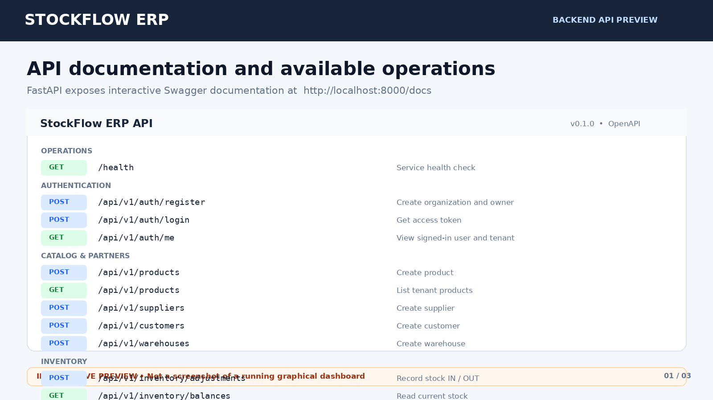
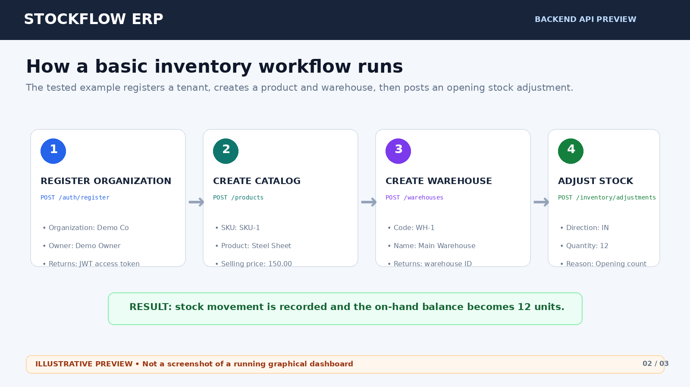
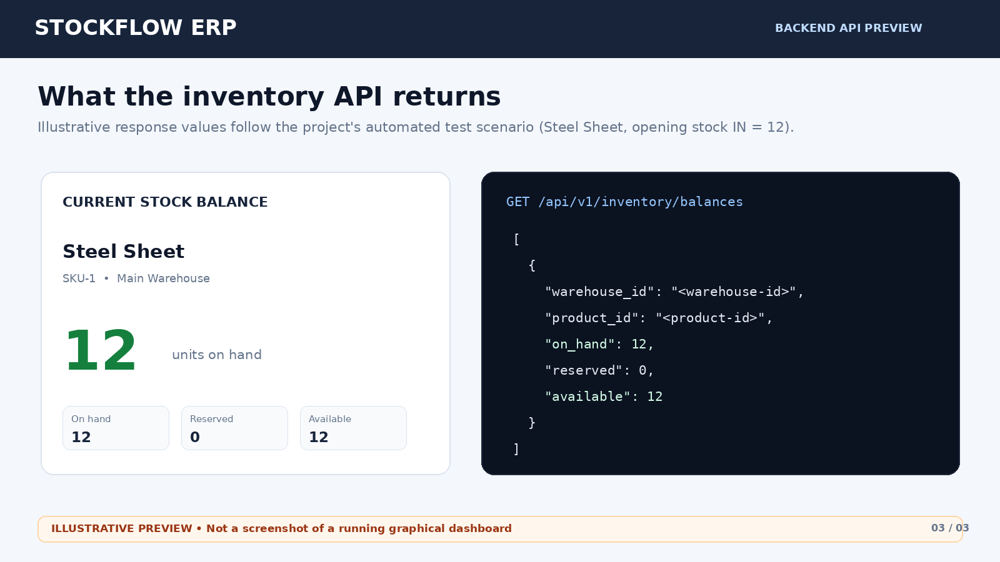

# StockFlow ERP — Inventory & Operations Management System

> A modular, multi-tenant ERP backend built with **Python, FastAPI, SQLAlchemy and PostgreSQL**, with an inventory ledger, REST APIs, automated tests and starter Power BI reporting assets.

**Project type:** Full Stack Python Developer portfolio project  
**Current implementation:** Backend-first ERP foundation with API documentation and illustrative reporting previews  
**Version:** `0.1.0`

---

## 1. Why I built this project

I built **StockFlow ERP** to explore how a business can manage products, warehouses and stock operations through one centralized system instead of relying on disconnected spreadsheets or manually maintained records.

In a small or growing business, inventory information can become difficult to trust when stock entries are recorded in different places. Teams need to know how much stock physically exists, how much has been reserved for orders, how much is available, and why a quantity changed.

I wanted to build a practical backend system that demonstrates the engineering behind those operations: authenticated users, organization-level data separation, structured APIs, relational data models, transaction-aware stock updates and an auditable movement history.

The project is also an opportunity for me to apply Python software development concepts to a realistic business use case and demonstrate how I structure, test and document a backend application.

## 2. What problem does it solve?

StockFlow provides a foundation for addressing common inventory-management problems:

| Business problem | How StockFlow addresses it |
|---|---|
| Stock information is scattered across spreadsheets or manual records | Stores inventory balances and stock movements in a relational database |
| Teams cannot easily distinguish physical stock from committed stock | Tracks `on_hand`, `reserved` and calculated `available` quantities |
| Stock changes are difficult to audit | Records movement type, quantity, before/after balance, reason and creator |
| Duplicate requests can accidentally add stock more than once | Uses an idempotency key and a database uniqueness constraint for stock movements |
| One organization's records could be exposed to another | Derives tenant context from the authenticated user and scopes business queries by organization |
| Invalid stock operations can create inconsistent balances | Validates quantities and prevents an adjustment from taking stock below the reserved amount |
| Applications need a consistent way to access business data | Exposes versioned REST APIs and interactive OpenAPI/Swagger documentation |

**Important scope note:** This repository is a working backend foundation, not a complete production ERP. The implemented API supports identity, catalog, partner, warehouse and core inventory operations. Several purchasing, sales, finance and fulfillment workflows are represented in the data model or planned, but are not yet complete end-to-end features.

## 3. Project screenshots

The screenshots below are the supplied project output previews. They are included in this repository under `docs/screenshots/` so they render directly on GitHub.

### 3.1 Inventory and operations dashboard preview

This preview communicates the intended inventory reporting experience: total units on hand, reserved units, available units, stock movement trend, warehouse stock and the latest movement.


### 3.2 API documentation preview

The API preview shows the available service operations grouped by area, including health, authentication, catalog, warehouse and inventory endpoints. The running FastAPI application exposes interactive Swagger documentation at `/docs`.



### 3.3 Inventory workflow preview

The workflow illustrates the tested opening-stock scenario: register an organization, create a product, create a warehouse and post an inventory adjustment.



### 3.4 Example inventory API response preview

The response preview illustrates the balance returned for the demo scenario: 12 units on hand, 0 reserved and 12 available.



> **Screenshot accuracy:** These are illustrative previews supplied with the project, not evidence of a live hosted service. The dashboard image is a reporting preview, not a running Power BI `.pbix` report or a frontend shipped in this repository. The API response and workflow previews show the demo/test scenario documented in the repository.

## 4. Technology stack

The following technologies and tools are present in the source repository.

| Technology | Purpose in this project |
|---|---|
| **Python 3.13+** | Main programming language |
| **FastAPI** | REST API framework and request handling |
| **Pydantic v2** | Request validation, schemas and settings |
| **SQLAlchemy 2.x** | ORM, database models and queries |
| **PostgreSQL 17** | Intended primary relational database in Docker Compose |
| **SQLite** | Convenient local-development and validation option |
| **Alembic** | Database schema migrations |
| **JWT (PyJWT)** | Signed access-token authentication |
| **Argon2** | Password hashing and verification |
| **Redis** | Cache/task-broker infrastructure configured in Compose |
| **Celery** | Background-task dependency included for future asynchronous workflows |
| **Docker & Docker Compose** | Container configuration for API, database and Redis |
| **Pytest & HTTPX** | Automated API workflow tests |
| **Ruff, mypy** | Development linting and type-checking tools included as optional dependencies |
| **SQL / DAX / Power BI** | Starter reporting views and inventory measures |

### Architecture

StockFlow follows a **modular monolith** architecture. The API layer handles HTTP requests, service functions contain business operations, SQLAlchemy models represent persisted data, and shared core modules provide configuration, database sessions and security.

```text
                 API Client / Swagger UI
                          |
                          v
                    FastAPI Application
                          |
                    Versioned API v1
                          |
          +---------------+----------------+
          |               |                |
          v               v                v
       Identity         Catalog          Inventory
       Module           Module           Service
          |               |                |
          +---------------+----------------+
                          |
                          v
                   SQLAlchemy ORM
                          |
                          v
                PostgreSQL / SQLite

      Redis + Celery: configured infrastructure
                    for future jobs

      SQL reporting views + DAX starter measures
                    for Power BI
```

## 5. Main modules and features

### Authentication and organization management

- Register an organization and its initial owner.
- Log in with email and password.
- Hash passwords using Argon2.
- Issue signed JWT access tokens.
- Resolve the authenticated user's organization membership.
- Apply role checks to selected write operations.

### Product and partner catalog

- Create and list organization-scoped products.
- Store SKU, name, description, purchase price, selling price and reorder level.
- Create suppliers and customers.
- Create warehouses with unique organization-level warehouse codes.
- Use decimal/numeric database types for monetary values.

### Inventory management

- Record stock IN and stock OUT adjustments.
- Maintain a current inventory balance for each organization, warehouse and product.
- Keep reserved quantity separate from physical on-hand stock.
- Calculate available quantity as:

\[
\text{Available} = \text{On Hand} - \text{Reserved}
\]

- Store stock movement history with before/after quantities.
- Prevent an adjustment from reducing on-hand stock below the reserved amount.
- Use idempotency keys to protect against duplicate processing of the same request.
- Read current inventory balances and recent stock movements through API endpoints.

A basic reservation service function is also present in the inventory service module. A complete reservation lifecycle and public reservation API are not yet implemented.

## 6. Complete project workflow

The repository's automated test scenario demonstrates the following opening-stock workflow.

### Step 1 — Register an organization

The user submits organization name, owner name, email and password.

**Endpoint:** `POST /api/v1/auth/register`

The backend creates the organization, user and owner membership, hashes the password and returns an access token.

### Step 2 — Authenticate and establish tenant context

The client sends the returned JWT in the `Authorization` header:

```http
Authorization: Bearer <access_token>
```

Protected endpoints validate the token and resolve the user's active organization membership. Business data is scoped to that organization.

### Step 3 — Create a product

**Endpoint:** `POST /api/v1/products`

The demo creates:

- SKU: `SKU-1`
- Product: `Steel Sheet`
- Purchase price: `100.00`
- Selling price: `150.00`
- Reorder level: `5`

### Step 4 — Create a warehouse

**Endpoint:** `POST /api/v1/warehouses`

The demo creates:

- Warehouse code: `WH-1`
- Warehouse name: `Main Warehouse`

### Step 5 — Record opening stock

**Endpoint:** `POST /api/v1/inventory/adjustments`

The test posts an IN adjustment with:

- Product: Steel Sheet
- Warehouse: Main Warehouse
- Direction: `IN`
- Quantity: `12`
- Reason: `Opening count verified`
- Idempotency key: `opening-stock-001`

The inventory service validates the organization, product and warehouse, updates the balance and inserts a stock movement in the same database transaction.

### Step 6 — Read the inventory balance

**Endpoint:** `GET /api/v1/inventory/balances`

The API returns the current stock projection for the authenticated organization.

### Step 7 — Read the stock movement history

**Endpoint:** `GET /api/v1/inventory/movements`

The API returns the recorded stock movement history, newest first.

### Workflow result

For the supplied demo scenario, the expected balance is:

| Metric | Result |
|---|---:|
| Product | Steel Sheet |
| Warehouse | Main Warehouse |
| Total units on hand | **12** |
| Units reserved | **0** |
| Available units | **12** |
| Stock movements | **1** |
| Movement type | `ADJUSTMENT_IN` |

The test also replays the same adjustment with the same idempotency key and verifies that the movement history still contains only one event.

## 7. API endpoints

The following endpoints are implemented in the current API router.

| Method | Endpoint | Authentication | Description |
|---|---|---|---|
| `GET` | `/health` | No | Service health check |
| `POST` | `/api/v1/auth/register` | No | Register organization and owner |
| `POST` | `/api/v1/auth/login` | No | Authenticate and receive access token |
| `GET` | `/api/v1/auth/me` | Yes | Get current user and tenant context |
| `POST` | `/api/v1/products` | Role-restricted | Create product |
| `GET` | `/api/v1/products` | Yes | List tenant products |
| `POST` | `/api/v1/suppliers` | Yes | Create supplier |
| `POST` | `/api/v1/customers` | Yes | Create customer |
| `POST` | `/api/v1/warehouses` | Yes | Create warehouse |
| `POST` | `/api/v1/inventory/adjustments` | Role-restricted | Record stock adjustment |
| `GET` | `/api/v1/inventory/balances` | Yes | Read current stock balances |
| `GET` | `/api/v1/inventory/movements` | Yes | Read stock movement history |

Interactive API documentation:

- Swagger UI: `http://localhost:8000/docs`
- ReDoc: `http://localhost:8000/redoc`
- OpenAPI JSON: `http://localhost:8000/openapi.json`

## 8. How to install and run the project

### Prerequisites

- Python **3.13 or later**
- Git
- pip
- PostgreSQL and Redis only if you choose the Docker/PostgreSQL setup

### Option A — Run locally with SQLite

This is the simplest way to start the API without installing PostgreSQL or Redis.

**1. Clone the repository**

```bash
git clone <your-github-repository-url>
cd StockFlow-ERP
```

Replace the placeholder with your actual GitHub repository URL.

**2. Create and activate a virtual environment**

Windows PowerShell:

```powershell
py -3.13 -m venv .venv
.venv\Scripts\Activate.ps1
```

Windows Command Prompt:

```cmd
.venv\Scripts\activate
```

Linux / macOS:

```bash
python3.13 -m venv .venv
source .venv/bin/activate
```

**3. Install the project and development dependencies**

```bash
python -m pip install --upgrade pip
pip install -e ".[dev]"
```

**4. Configure environment variables**

Create a `.env` file in the project root:

```env
APP_NAME=StockFlow ERP
ENVIRONMENT=development
DEBUG=true
API_V1_PREFIX=/api/v1
DATABASE_URL=sqlite:///./stockflow.db
JWT_SECRET_KEY=replace-this-with-a-long-random-development-secret
JWT_ALGORITHM=HS256
ACCESS_TOKEN_MINUTES=20
REFRESH_TOKEN_DAYS=14
REDIS_URL=redis://localhost:6379/0
CORS_ORIGINS=http://localhost:5173
```

The SQLite URL is suitable for local API development. Redis is not required to run the currently implemented synchronous API endpoints.

**5. Apply database migrations**

```bash
alembic upgrade head
```

**6. Start the FastAPI server**

```bash
uvicorn app.main:app --reload
```

**7. Open the application**

Visit:

```text
http://localhost:8000/docs
```

Use Swagger UI to register an organization, authorize with the returned bearer token, create a product and warehouse, and record a stock adjustment.

### Option B — Run with Docker Compose and PostgreSQL

**1. Create the environment file**

Copy `.env.example` to `.env` and update the database password and JWT secret.

Windows PowerShell:

```powershell
Copy-Item .env.example .env
```

Linux / macOS:

```bash
cp .env.example .env
```

Set a strong `JWT_SECRET_KEY` and a non-default `POSTGRES_PASSWORD` in `.env`.

**2. Build and start the services**

```bash
docker compose up --build -d
```

This Compose configuration starts:

- FastAPI application
- PostgreSQL 17
- Redis 7

**3. Apply migrations**

```bash
docker compose exec api alembic upgrade head
```

**4. Open Swagger UI**

```text
http://localhost:8000/docs
```

**5. Stop the services**

```bash
docker compose down
```

To remove the local database volume as well (this deletes its persisted data):

```bash
docker compose down -v
```

> Docker Compose is included in the repository, but the supplied validation report says Docker Compose execution was not tested in the build environment. PostgreSQL and Redis runtime integration should therefore be verified on your machine.

## 9. Example API requests

After starting the API, register an organization:

```bash
curl -X POST "http://localhost:8000/api/v1/auth/register" \
  -H "Content-Type: application/json" \
  -d '{
    "organization_name": "Demo Co",
    "full_name": "Demo Owner",
    "email": "owner@example.com",
    "password": "StrongPass123!"
  }'
```

Copy the returned `access_token` and use it in the following requests.

Create a product:

```bash
curl -X POST "http://localhost:8000/api/v1/products" \
  -H "Authorization: Bearer <access_token>" \
  -H "Content-Type: application/json" \
  -d '{
    "sku": "SKU-1",
    "name": "Steel Sheet",
    "purchase_price": "100.00",
    "selling_price": "150.00",
    "reorder_level": 5
  }'
```

Create a warehouse:

```bash
curl -X POST "http://localhost:8000/api/v1/warehouses" \
  -H "Authorization: Bearer <access_token>" \
  -H "Content-Type: application/json" \
  -d '{
    "code": "WH-1",
    "name": "Main Warehouse"
  }'
```

Record an opening stock adjustment (replace the IDs with the IDs returned by the previous requests):

```bash
curl -X POST "http://localhost:8000/api/v1/inventory/adjustments" \
  -H "Authorization: Bearer <access_token>" \
  -H "Content-Type: application/json" \
  -d '{
    "warehouse_id": "<warehouse-id>",
    "product_id": "<product-id>",
    "quantity": 12,
    "direction": "IN",
    "reason": "Opening count verified",
    "idempotency_key": "opening-stock-001"
  }'
```

Read the current balance:

```bash
curl "http://localhost:8000/api/v1/inventory/balances" \
  -H "Authorization: Bearer <access_token>"
```

The demo balance contains these values (the UUIDs are generated at runtime):

```json
[
  {
    "warehouse_id": "<warehouse-id>",
    "product_id": "<product-id>",
    "on_hand": 12,
    "reserved": 0,
    "available": 12
  }
]
```

## 10. Database design

The SQLAlchemy models define the following main entities:

| Entity | Responsibility |
|---|---|
| `Organization` | Tenant/business account |
| `User` | Login identity |
| `Membership` | User's organization membership and role |
| `Product` | SKU and product details |
| `Supplier` | Supplier records |
| `Customer` | Customer records |
| `Warehouse` | Physical stock location |
| `InventoryBalance` | Current stock projection |
| `StockMovement` | Auditable stock event ledger |
| `PurchaseOrder` / `PurchaseOrderItem` | Purchase order data model |
| `SalesOrder` / `SalesOrderItem` | Sales order data model |
| `Invoice` | Basic invoice data model |

The current balance and movement ledger serve different purposes:

- `inventory_balances` stores the current stock position for fast reads.
- `stock_movements` stores the events that explain how stock changed.

The adjustment service updates both within one transaction. Database constraints help enforce non-negative stock, valid reservation relationships, organization-scoped SKU/warehouse uniqueness and movement idempotency.

## 11. Challenges addressed and engineering decisions

These are the main implementation challenges reflected in the code and design.

### 1. Keeping organization data separated

**Challenge:** A multi-organization application must not return one tenant's products or inventory to another tenant.

**How I addressed it:** The authenticated identity is resolved from a signed JWT and active membership. Tenant-owned API queries include the resolved `organization_id`, rather than trusting a client-supplied organization ID for normal business operations. The test suite includes a basic cross-tenant product-list isolation test.

**Why:** Tenant context should be established by the server from authenticated identity, not accepted blindly from the request body.

### 2. Maintaining a reliable stock balance

**Challenge:** A stock adjustment must update the current quantity and preserve a record of the event that caused the change.

**How I addressed it:** I separated the current `InventoryBalance` projection from the `StockMovement` history. The inventory service updates the balance and creates the movement in the same database transaction.

**Why:** This provides a fast current-stock query while retaining an audit trail for investigation.

### 3. Preventing duplicate stock updates

**Challenge:** A client may retry a request after a timeout. Processing the same request twice could incorrectly increase or decrease stock twice.

**How I addressed it:** Stock adjustments accept an idempotency key. The service checks for an existing movement, and the database has a unique constraint on organization and idempotency key. The automated workflow test replays a request and verifies that only one movement exists.

**Why:** Retried requests should not create duplicate business effects.

### 4. Protecting reserved quantities

**Challenge:** Physical stock may include units already committed to orders. A manual stock-out must not consume those reserved units.

**How I addressed it:** The service checks that the adjusted on-hand quantity will not fall below `reserved`. The database balance model also has a check constraint for non-negative quantities and `reserved <= on_hand`.

**Why:** Available stock must remain meaningful and must not become negative.

### 5. Structuring a maintainable backend

**Challenge:** Putting authentication, validation, database operations and inventory rules into one large route file would make the application difficult to extend.

**How I addressed it:** I separated shared configuration/security/database code from identity, catalog and inventory modules. Pydantic schemas validate incoming requests, while service functions hold core use cases.

**Why:** Clear module boundaries make it easier to test, debug and extend the application.

### 6. Supporting repeatable database setup

**Challenge:** Database schema changes need to be applied consistently across environments.

**How I addressed it:** I included SQLAlchemy models and Alembic migrations, plus Docker Compose configuration for PostgreSQL and Redis.

**Why:** Versioned migrations and reproducible service configuration are useful foundations for team development and deployment.

## 12. Testing and validation

The repository includes automated tests in `tests/test_api_workflow.py`.

The validation report included in the repository records these checks:

| Validation | Recorded result |
|---|---|
| Python compile check (`compileall`) | Passed |
| Pytest workflow suite | **3 tests passed** |
| Alembic migration using disposable SQLite database | Completed |
| Application import and OpenAPI generation | Passed |
| Docker Compose runtime validation | Not run |
| PostgreSQL integration/concurrency tests | Not run |
| Redis/Celery runtime checks | Not run |
| Coverage percentage | Not measured |

Run the test suite locally:

```bash
pytest -q
```

Run Python compilation checks:

```bash
python -m compileall -q app migrations scripts tests
```

The three tests cover health and registration, the product/warehouse/stock-ledger workflow including idempotent replay, and a basic cross-tenant product-list isolation check.

## 13. Current limitations

I have intentionally documented the boundaries of this version rather than presenting planned functionality as completed.

- The repository is a backend-first implementation; a React or other browser-based frontend is not included.
- The supplied dashboard is an illustrative reporting preview, not a live Power BI report.
- Power BI SQL views and DAX measures are starter assets, not a complete BI model or star schema.
- Full purchase-order processing and goods-received-note (GRN) workflows are not implemented end to end.
- Complete sales order, fulfillment, dispatch, invoicing, payment and returns workflows are not implemented.
- Inventory reservation has a service-level function, but release and complete reservation lifecycle APIs are missing.
- Stock transfer and reconciliation workflows are not complete.
- Authentication currently implements password hashing and access JWTs; refresh-token rotation, revocation, logout, password reset and email verification remain future work.
- Multi-tenancy is enforced through application-level organization scoping in exposed routes; PostgreSQL row-level security and comprehensive isolation tests remain future work.
- Role checks exist for selected operations, but a complete permission catalog and administration workflow are not implemented.
- Redis and Celery dependencies/infrastructure are configured, but background workers and task workflows are not implemented.
- Production rate limiting, full observability, deployment automation and additional hardening remain future work.
- The current implementation uses synchronous SQLAlchemy sessions.
- Production-grade concurrent creation/locking of a previously missing inventory balance row needs additional handling and retry logic.
- The development JWT secret must be replaced with a strong secret outside local development.

## 14. Future improvements

My next development steps for StockFlow ERP are:

1. Complete purchase orders, goods receipt and supplier workflows.
2. Implement the complete sales order, reservation, dispatch and invoice lifecycle.
3. Add stock transfers, reservation release and inventory reconciliation.
4. Strengthen tenant isolation with PostgreSQL row-level security and expanded security tests.
5. Implement refresh-token rotation, revocation, password reset and login throttling.
6. Add concurrency and PostgreSQL integration tests for inventory operations.
7. Implement Celery workers, Redis-backed jobs and reliable event processing.
8. Build a frontend for day-to-day inventory operations.
9. Expand the Power BI model with a proper reporting schema and validated business KPIs.
10. Add production deployment, monitoring, backups and rate limiting.

## 15. Repository structure

```text
StockFlow-ERP/
├── app/
│   ├── api/
│   │   └── v1/
│   │       └── router.py
│   ├── core/
│   │   ├── config.py
│   │   ├── database.py
│   │   ├── dependencies.py
│   │   └── security.py
│   ├── modules/
│   │   ├── identity/
│   │   ├── catalog/
│   │   └── inventory/
│   └── main.py
├── migrations/
│   └── versions/
├── powerbi/
│   ├── dax/
│   │   └── measures.dax
│   └── sql/
│       └── reporting_views.sql
├── scripts/
├── tests/
│   └── test_api_workflow.py
├── docs/
│   ├── screenshots/
│   ├── API_DOCUMENTATION.md
│   ├── DATABASE_DESIGN.md
│   ├── DEPLOYMENT.md
│   ├── FINAL_VALIDATION_REPORT.md
│   ├── IMPLEMENTATION_STATUS.md
│   ├── POWER_BI_GUIDE.md
│   └── SYSTEM_DESIGN.md
├── .env.example
├── alembic.ini
├── docker-compose.yml
├── Dockerfile
└── pyproject.toml
```

## 16. What this project demonstrates about my skills

As a **Full Stack Python Software Developer**, I use this project to demonstrate practical experience with:

- Python application development and modular code organization.
- REST API development using FastAPI.
- Request validation and API documentation.
- Relational database design and SQLAlchemy ORM.
- Database migrations with Alembic.
- Authentication, password hashing and JWT-based authorization.
- Multi-tenant data scoping.
- Transactional business logic and idempotent operations.
- Automated API testing with Pytest and HTTPX.
- Docker-based development configuration.
- SQL and DAX starter reporting assets.
- Technical documentation and honest project-scope management.

The project currently demonstrates backend engineering more substantially than frontend development. I plan to extend it with a browser-based user interface and complete reporting workflows.

---

## Author

**Rohit Kumar**  
Full Stack Python Software Developer

- GitHub: [github.com/rohitkumar-ds](https://github.com/rohitkumar-ds)
- LinkedIn: [linkedin.com/in/rohit-369abc](https://www.linkedin.com/in/rohit-369abc)

---

*StockFlow ERP is an educational and portfolio project. It is not presented as a fully production-hardened ERP or as a certified accounting/tax-compliance system.*
