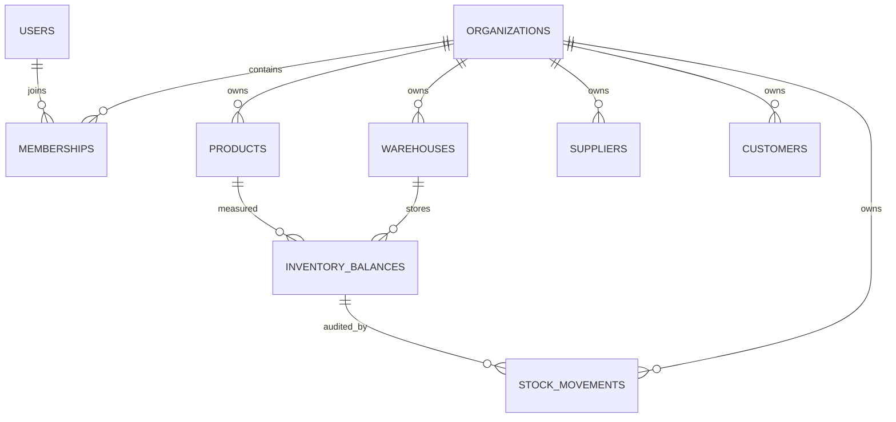

# Database design

Core relationships:

All money uses `NUMERIC(14,2)`. Timestamps are timezone-aware at the model layer. Tenant and lookup columns are indexed. Product SKU and warehouse code are unique within an organization. Stock movement idempotency keys are unique within an organization.

The current ER diagram intentionally documents the implemented schema only; procurement, sales, payments, returns and dimensional BI tables are future migrations.
