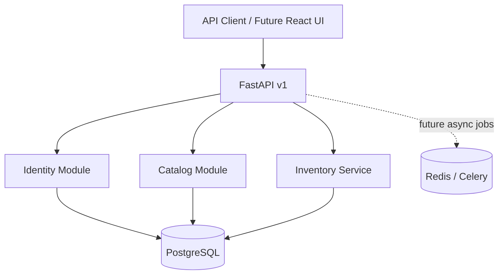

# System design

## Architectural style
StockFlow is structured as a modular monolith. FastAPI is the presentation boundary, service functions hold business use cases, SQLAlchemy models represent persistence, and `core` provides cross-cutting configuration, database and security facilities.

## Inventory accounting model
`inventory_balances` is a current-state projection for fast reads. `stock_movements` is the audit history. A successful adjustment updates the projection and inserts the matching movement in one database transaction. The `before_on_hand` and `after_on_hand` columns make the event inspectable. `reserved` is a separate quantity and available stock is `on_hand - reserved`.

PostgreSQL uses `SELECT ... FOR UPDATE` to serialize writers for an existing balance row. A production implementation must also safely create/lock missing balance rows (for example, transaction-scoped advisory lock or insert-on-conflict followed by row lock) and retry serialization/deadlock errors. The unique idempotency constraint protects duplicate request processing.

## Tenant model
Users may hold organization memberships. The API derives organization scope from the validated JWT subject plus an active membership lookup. Client-supplied organization IDs are not accepted for normal tenant data writes. Every tenant-owned query includes organization scope.

## Decisions and trade-offs
- A modular monolith keeps deployment and transaction boundaries understandable for an interview portfolio.
- PostgreSQL is the operational source of truth; Redis is only an optional cache/task broker.
- Decimal/Numeric is used for monetary values.
- Soft archival (`is_active`) is preferred over deleting products and partner records with history.
